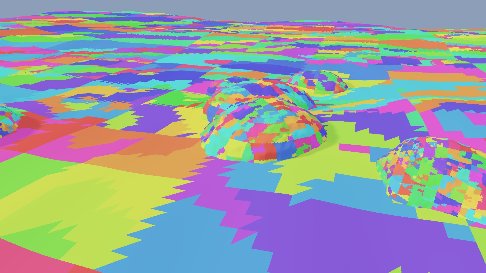
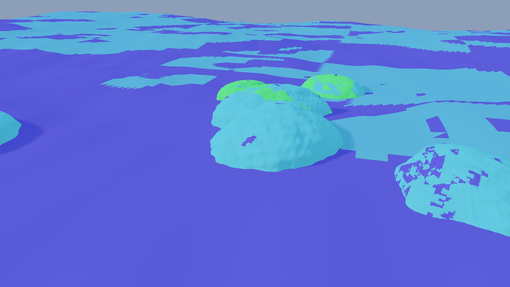
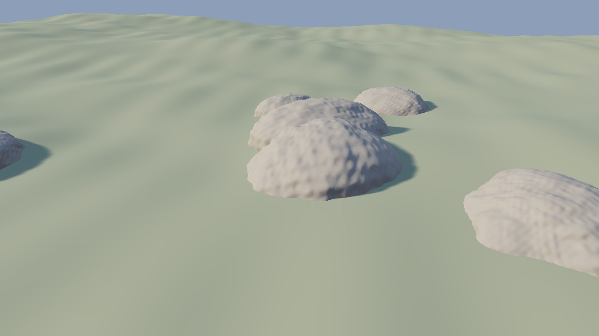

## Why

STRATA cuts geometry into clusters and decides every frame which detail level to show for each piece of the scene. Without a visualisation none of that is visible: the image just looks like a normal render. The debug view draws exactly the clusters STRATA selected over the frame, so you can see where it refines, where it simplifies, and where something went wrong.



## What it draws

The debug view uses the **actually selected** frontier, not a recomputed one: the clusters the last successful `prepareModel` wrote into the draw. Over the frame it can show:

- the bounds (AABB) of each selected cluster;
- a wireframe of each cluster's triangle edges;
- a translucent fill in the cluster's colour;
- the instance box, coloured by draw route.

Colour comes from one of four modes:

| Mode | What it shows |
| --- | --- |
| `Cluster` | a stable colour per cluster; adjacent pieces differ |
| `LodDepth` | hierarchy depth: red = coarse root, blue = finest leaf |
| `Error` | the cluster's geometric error on a log scale |
| `Material` | the material or primitive partition |

Instance boxes say a lot too: green = STRATA on the portable path, cyan = Vulkan GPU indirect (bounds only: that route has no CPU frontier), orange = a STRATA source that fell back to the normal render this frame, grey = not STRATA.



## Presentation only

The view changes nothing in how STRATA works: it does not select LODs, touch routing, upload GPU data or read back GPU selections. It draws ordinary `Renderer3D` lines and triangles and is off by default. Code that configures `GeometryScene` turns it on:

```cpp
scene.setStrataPortableRenderingEnabled(true);
scene.setStrataDebugGeometryCaptureEnabled(true); // before load: for wireframe and fill
scene.load(device, json, reader);
strata::DebugViewOptions debug;
debug.enabled = true;
debug.clusterWireframe = true;
debug.color = strata::DebugColorMode::LodDepth;
scene.setStrataDebugView(debug);
```

## The frames on this site

The scene is procedural terrain (about 105 k triangles) and 20 rocks (about 82 k each), about 1.7 M source triangles in total. STRATA selected 15,280 clusters in the frame: small finest-level clusters up close, increasingly coarse ones towards the horizon. Captured on Linux through OpenGL (Mesa llvmpipe) at 1920×1080.



## Limits

- Wireframe and fill need CPU vertex positions, which are released after the GPU upload. The capture is therefore turned on **before** the scene loads and copies positions of STRATA sources only. Without it only bounds are drawn.
- Each frame has a primitive cap (262,144 lines and 131,072 triangles by default, shared by all instances); anything above it is not drawn and is counted in the stats.
- The view shows one conservative frontier shared by the main camera and the sun shadow, not a main-camera-only cut.
- Neither a game host nor the editor viewport enables portable STRATA yet, so the view is reachable from code only. There is no editor or MCP toggle yet.
- Not captured on Metal or other GPUs. Scene triangles are Morton-ordered: with the procedural mesh's original order clusters came out as strips — worth checking on real assets.

More in the [STRATA documentation](../../../strata.md#debug-visualisation-of-clusters-and-geometry-2026-11-21).
