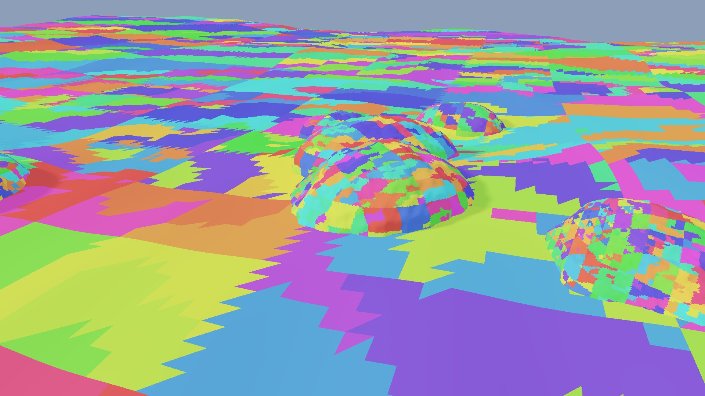
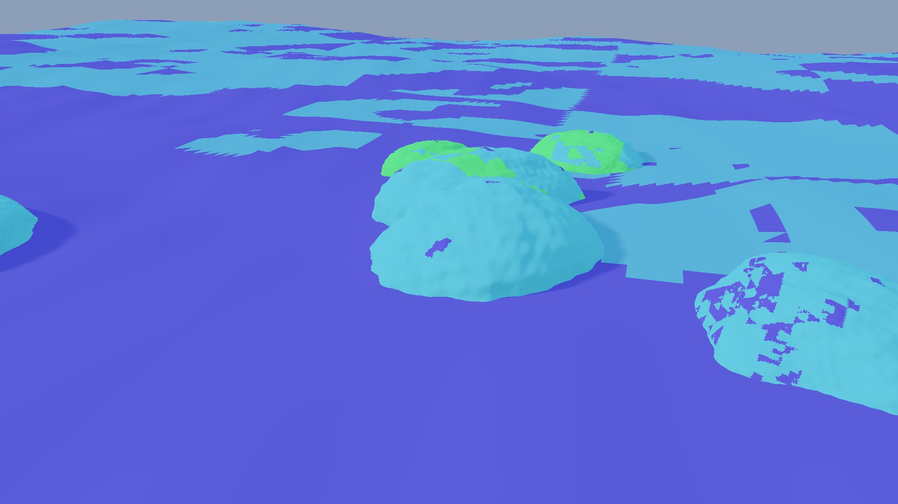
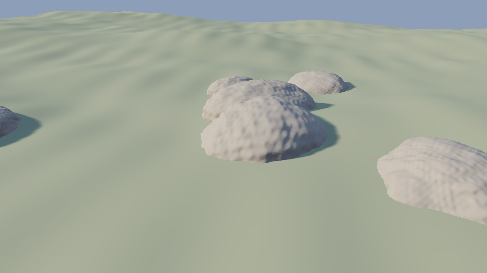

## Зачем

STRATA режет геометрию на кластеры и каждый кадр решает, какой уровень детализации показать для каждого куска сцены. Без визуализации этого не видно: картинка просто выглядит как обычный рендер. Отладочный вид рисует поверх кадра ровно тот набор кластеров, который STRATA выбрала, — так видно, где она детализирует, а где упрощает, и где что-то пошло не так.



## Что рисует

Отладочный вид берёт не пересчитанный, а **фактически выбранный** фронтир — те кластеры, которые последний успешный `prepareModel` записал в отрисовку. Поверх кадра он может показать:

- рамки (AABB) каждого выбранного кластера;
- каркас — рёбра треугольников каждого кластера;
- полупрозрачную заливку кластера его цветом;
- рамку экземпляра, окрашенную по маршруту отрисовки.

Цвет выбирается одним из четырёх режимов:

| Режим | Что показывает |
| --- | --- |
| `Cluster` | устойчивый цвет на кластер, соседние куски различаются |
| `LodDepth` | глубина в иерархии: красный — грубый корень, синий — финальный лист |
| `Error` | геометрическая ошибка кластера, в логарифмической шкале |
| `Material` | материал или часть примитива |

Рамки экземпляров тоже говорят о многом: зелёный — STRATA на переносимом пути, голубой — GPU indirect на Vulkan (только рамка: CPU-фронтира у этого маршрута нет), оранжевый — источник STRATA, который в этом кадре ушёл на обычный рендер, серый — не STRATA.



## Только презентация

Режим ничего не меняет в работе STRATA: не выбирает LOD, не трогает маршрутизацию, не загружает данные на GPU и не читает обратно GPU-выборку. Он рисует обычными линиями и треугольниками `Renderer3D` и по умолчанию выключен. Включается из кода, который настраивает `GeometryScene`:

```cpp
scene.setStrataPortableRenderingEnabled(true);
scene.setStrataDebugGeometryCaptureEnabled(true); // до load: для каркаса и заливки
scene.load(device, json, reader);
strata::DebugViewOptions debug;
debug.enabled = true;
debug.clusterWireframe = true;
debug.color = strata::DebugColorMode::LodDepth;
scene.setStrataDebugView(debug);
```

## Кадры на сайте

Сцена для кадров — процедурный рельеф (около 105 тыс. треугольников) и 20 камней (около 82 тыс. каждый), всего около 1,7 млн треугольников исходной геометрии. В кадре STRATA выбрала 15 280 кластеров: вблизи — мелкие кластеры финального уровня, к горизонту — всё более крупные. Сняты на Linux через OpenGL (Mesa llvmpipe), 1920×1080.



## Ограничения

- Каркасу и заливке нужны позиции вершин на CPU, а после загрузки на GPU они освобождаются. Поэтому захват включается **до** загрузки сцены и копирует позиции только источников STRATA. Без него рисуются только рамки.
- На кадр есть потолок примитивов (по умолчанию 262 144 линии и 131 072 треугольника на все экземпляры); всё сверх него не рисуется и считается в статистике.
- Показан один консервативный фронтир — общий для основной камеры и тени солнца, а не срез только под основную камеру.
- Ни игровой хост, ни вьюпорт редактора пока не включают переносимый STRATA, поэтому режим доступен только из кода. Переключателя в редакторе и в MCP ещё нет.
- Кадры не сняты на Metal и других GPU. Треугольники сцены упорядочены по коду Мортона: на исходном порядке процедурной сетки кластеры получались полосами — это стоит проверить на реальных ассетах.

Подробнее — в [документации STRATA](../../../strata.md#debug-visualisation-of-clusters-and-geometry-2026-11-21).
