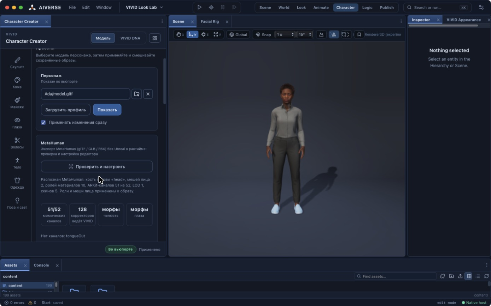

# VIVID Character Creator и адаптер MetaHuman

Character Creator — редактор внешности цифрового человека в AIVERSE Studio. Он работает с персонажем
проекта (glTF / GLB / FBX) или с процедурной ДНК VIVID и показывает результат в нативном вьюпорте.
Открывается в рабочем пространстве **Character** (⌘7 или вкладка вверху).

## Быстрый старт

1. **Пресеты → Персонаж:** выберите модель, нажмите «Загрузить профиль» и «Показать».
2. Для экспорта MetaHuman нажмите **«Проверить и настроить»**: роли материалов и меши лица
   выставятся сами (см. ниже).
3. Меняйте категории слева: Лицо, Скульпт, Кожа, Макияж, Глаза, Волосы, Тело, Одежда, Поза и свет.
   При включённом «Применять изменения сразу» вьюпорт обновляется на ходу.
4. Сохраните образ в «Образах» (с превью), соберите персонажа в «Одежде» и нажмите **«В игру»**.

## Категории

- **Пресеты.** Образы-карточки с превью, смешивание двух образов, возраст одним ползунком,
  случайный персонаж с замками, черновик по описанию («пожилой рыбак, седые волосы…») и запрос
  для агента, толпа из N вариантов, пакет персонажа `.aivchar` для переноса между проектами.
- **Лицо.** Круг смешивания шести архетипов; отдельные части (нос, рот, глаза, брови, челюсть,
  скулы) получают свою ручку — кнопкой или кликом по лицу во вьюпорте. Пропорции и импорт лица
  из скана, фото или отдельной головы. Полупрозрачный референс поверх вьюпорта.
- **Скульпт.** Кисть «вытянуть / вдавить» протяжкой по лицу, круг кисти, симметрия, история.
- **Кожа, глаза, волосы.** Тон, фактура, поры, веснушки; радужка и склера; цвет и седина прядей.
- **Макияж.** Помада, румяна, тени, щетина — слои на текстуре кожи. «Разместить по лицу» находит
  губы, щёки и веки по геометрии; положение можно поправить вручную.
- **Тело.** Рост в сантиметрах, пропорции, линейка с делениями по 10 см во вьюпорте.
- **Одежда.** Комплект модели и вещи с примеркой во вьюпорте, цвет каждой вещи, причёски из
  проекта. Сборка пишет `content/Characters/<имя>/model.glb` с LOD для скинованных частей и
  показывает бюджет треугольников; «В игру» добавляет тип юнита с этой моделью.
- **Поза и свет.** Мимика для проверки (улыбка, смех, удивление, речь…), позы, клипы модели и
  анимации из файлов (через `<модель>.clips.json`), восемь световых пресетов.

Сверху: камера Лицо / Торс / Рост, «До/после» (удерживайте — исходная модель), ⌘Z / ⇧⌘Z.

## Адаптер MetaHuman

Без Unreal и без `.dna` в рантайме. Адаптер читает обычный экспорт MetaHuman и:

- узнаёт скелет UE5 (`spine_05`, `neck_02`, `head`), FaceMesh и кости `FACIAL_*`;
- расставляет роли материалов: кожа головы и тела, глаза, ресницы, волосы и брови, одежда;
  оболочки глаз, слёзы, слюна и хрящ скрываются, зубы сохраняют исходный материал;
- выбирает меши лица и считает, сколько из 52 мимических каналов ARKit есть в модели;
- в превью ведёт суставы `*_half` (половина сгиба) и твисты предплечья, а челюсть и глаза —
  по каналам ARKit, если морфы их ещё не двигают.

Проверено на экспортах Ada и Bruce (тест `vivid_metahuman_adapter`).

**Не поддерживается:** полный RigLogic (корректоры bulge, in/out, fwd/bck стоят в bind pose),
анимация остальных лицевых костей (мимика идёт через морфы), грум прядями (только карточки),
чтение `.dna` в игре (только офлайн-инструмент `tools/vivid-dna-import`). GLB со сжатием Draco
распакуйте офлайн: `node tools/vivid-dna-import/decompress_draco.cjs <tooling> in.glb out.glb`.

## Для агентов (MCP)

- `human_metahuman_check {path, save_look?}` — отчёт адаптера и образ с ролями.
- `human_look_schema`, `human_look_list`, `human_look_get`, `human_look_save` — образы.
- `studio_character_snapshot {view}` — PNG вьюпорта Character Creator (Studio должна быть открыта).
- `human_schema`, `human_create`, `human_edit` … — процедурная ДНК VIVID.

Подробный журнал разработки: [vivid.md](vivid.md).
